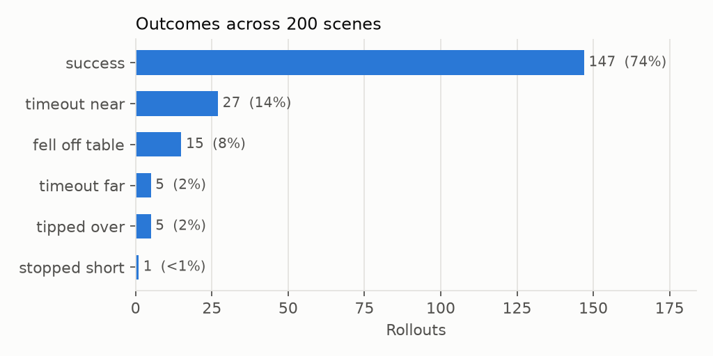
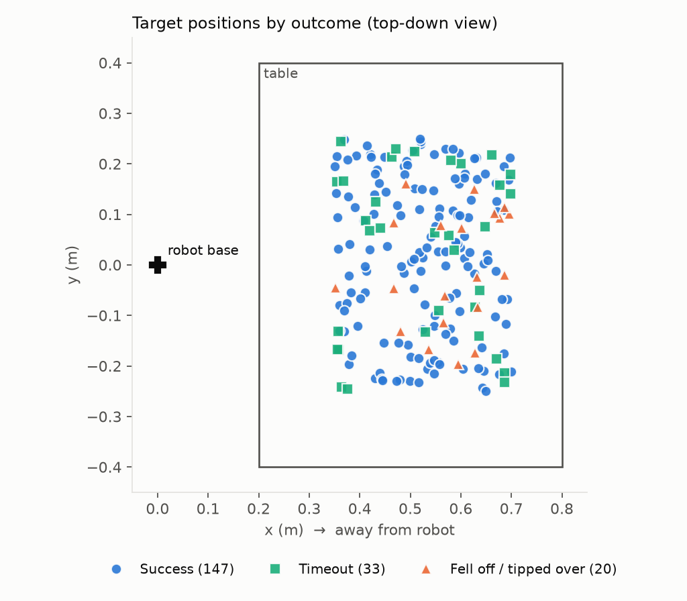
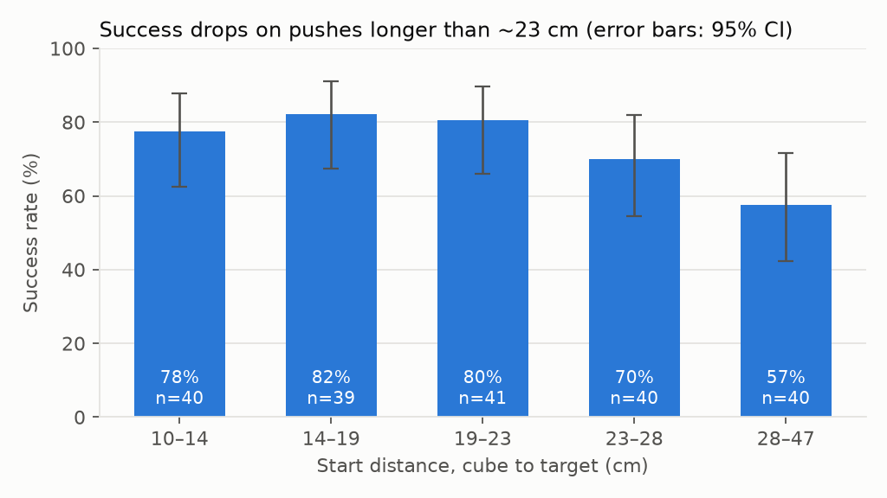

# SimEval: scene generation and graded rollouts for robot pushing in MuJoCo

A small evaluation harness for a robot manipulation task. It generates randomized simulation scenes, runs a robot controller in each one, grades every rollout with explicit rules, and reports the success rate with confidence intervals plus a breakdown of how it fails.

**Task:** a Franka Emika Panda arm pushes a 4 cm cube across a table onto a target marker.



## Results

The eval found a controller bug; fixing it raised success from **73.5% to 99.5%** on the original 200 scenes, and from **75.5% to 99.0% on 200 fresh scenes (seed 2) that were never used while designing the fix.**

| | Seed 0 (used to find the bug) | Seed 2 (held out) |
|---|---|---|
| v1 controller | 147/200 = 73.5% (95% CI 67.0–79.1%) | 151/200 = 75.5% (95% CI 69.1–80.9%) |
| **v2 controller** | **199/200 = 99.5%** (95% CI 97.2–99.9%) | **198/200 = 99.0%** (95% CI 96.4–99.7%) |
| Paired change | 52 scenes fixed, 0 broken (McNemar p = 4e-16) | 47 fixed, 0 broken (McNemar p = 1e-14) |

A rollout succeeds if, after 0.5 s of settling, the cube's centre is within 3 cm of the target, the cube is still on the table, and it is tilted less than 15°. The grader, the 15 s time budget and the scenes were identical before and after; only the controller changed.

### What the v1 eval showed (seed 0)

| Outcome | Count | Share |
|---|---|---|
| success | 147 | 73.5% |
| timeout_near (out of time, within 8 cm) | 27 | 13.5% |
| fell_off_table | 15 | 7.5% |
| timeout_far | 5 | 2.5% |
| tipped_over | 5 | 2.5% |
| stopped_short | 1 | 0.5% |

- **All 15 fell-off-table failures had the same cause, a controller bug.** Every cube fell off the edge nearest the robot, during the re-approach after a re-alignment. When the cube is close to the robot, the stand-off point behind it lies near the arm's base, where the inverse kinematics couldn't lift the gripper while keeping it vertical. The gripper slid at table height toward the robot, and because the stand-off point was recomputed from the moving cube, it kept pushing the cube until it dropped off.
- **Push distance mattered:** about 80% success up to ~23 cm, falling to 57% for the longest pushes.
- **Cube mass (0.05–0.5 kg) and friction (0.3–1.2) showed no clear effect;** the per-bin confidence intervals overlap heavily.
- **The largest failure mode was `timeout_near`:** close to the target, but out of time.

### The fix, in two iterations
1. **Lift first, freeze the goal:** rise straight up before moving sideways, and fix the stand-off point when the approach starts. On seed 0 this looked like a clear win (73.5% → 82.5%). **On held-out seed 1 it wasn't significant** (70.5% → 72.5%, p = 0.6): fell-off failures went to zero, but most of those scenes became timeouts, because the safer approach was slower.
2. **Move faster in free space, stay slow while pushing:** the arm's step limit was raised for approach and lift only. This removed the timeouts: 99.5% on seed 0, 99.0% on seed 1, and 99.0% on the untouched seed 2 with no scene getting worse.

The lesson: the first fix only looked good on the scenes used to design it. The held-out set caught the trade-off.




## How it works

| Stage | File | What it does |
|---|---|---|
| Scene generation | `scene_gen.py` | Samples cube position/yaw, target, mass and friction from a seeded RNG; rejects invalid scenes; saves parameters to JSON |
| Environment | `env.py` | Attaches the Panda (MuJoCo Menagerie) to the task scene with `MjSpec`; applies scene parameters |
| Controller | `controller.py` | Scripted pusher: damped least-squares inverse kinematics plus a closed-loop plan (approach → descend → push → re-align if the cube drifts) |
| Grader | `grader.py` | Independent of the controller: re-measures after settling, checks table/tilt/time, assigns one outcome per rollout, records metrics |
| Benchmark | `benchmark.py` | Runs all scenes in parallel, saves raw results (JSON/CSV), reports Wilson confidence intervals and per-property breakdowns |
| Comparison | `compare.py` | Paired before/after comparison on the same scenes, with an exact McNemar test |
| Report | `report.py` | Charts, example videos per outcome, markdown summary |

**Design choices**
- **Seeded and deterministic:** the same seed and MuJoCo version reproduce identical numbers on different machines.
- **The grader doesn't trust the controller:** the controller stops at 2 cm; the grader uses its own 3 cm rule after physics settles and checks failure modes the controller never looks at.
- **Every result is traceable:** each row stores its scene parameters, so a failure can be traced to the exact scene and replayed (`python run_one.py --scene N`).

**Problems found while building it**
- The Panda's fingers (~4.4 cm) are shorter than a 5 cm cube, so the palm jammed the cube. Switched to a 4 cm cube.
- Changing the cube's mass at runtime made contacts unstable until derived model constants were recomputed with `mj_setConst`.
- An open-loop push drifted off-line; the controller now re-aligns when the cube moves sideways or it overshoots.
- The re-approach bulldozed cubes off the table near the robot (found by the eval itself; see Results).

## Reproduce

```bash
python -m venv .venv && source .venv/bin/activate
pip install -r requirements.txt
./reproduce.sh            # add --videos to also render example rollouts
```
Runs in under a minute on a laptop (videos take a few minutes). Watch a single rollout live on macOS with `mjpython run_one.py --scene 19 --watch`.

## Limitations
- Simulation only; no sim-to-real validation.
- One task and one scripted controller; the eval harness is the focus, not the policy.
- At 99% success, 200 scenes can't separate small differences; comparing future controllers needs harder scenes or more of them.
- The remaining failures are long pushes that run out of time.
- Contact parameters are MuJoCo defaults, not calibrated against real hardware.

## Built with
MuJoCo 3.17, [MuJoCo Menagerie](https://github.com/google-deepmind/mujoco_menagerie) (Franka Panda model), NumPy, Matplotlib.