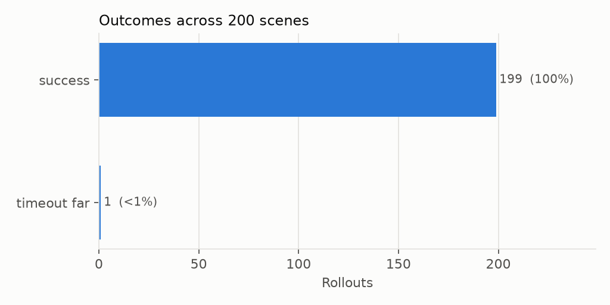
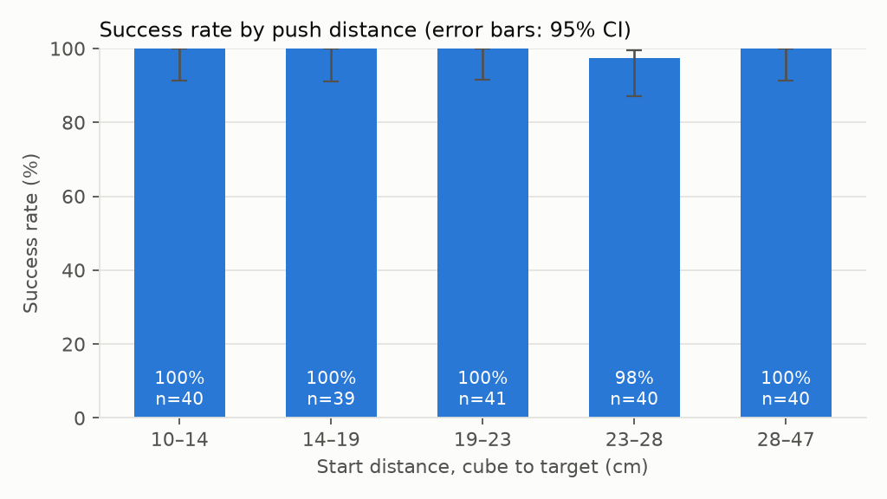
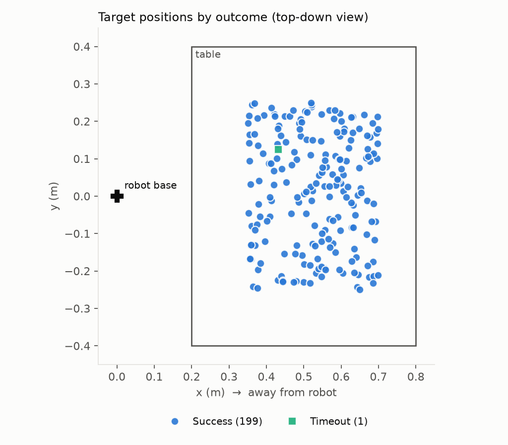

# SimEval report: `scenes_seed0`

**Task:** Franka Panda pushes a 4 cm cube onto a target. **Scenes:** 200 randomized (cube pose, target, mass 0.05–0.5 kg, friction 0.3–1.2).

**Success rate: 199/200 = 99.5%** (95% CI 97.2%–99.9%). Success = cube centre within 3 cm of target after 0.5 s settling, on the table, tilt < 15°.

| Outcome | Count | Share |
|---|---|---|
| success | 199 | 99.5% |
| timeout_far | 1 | 0.5% |

## Example rollouts

- [success_scene0.mp4](success_scene0.mp4): final distance 1.76 cm, 2 re-alignments, mass 0.46 kg, friction 0.85
- [success_scene1.mp4](success_scene1.mp4): final distance 1.83 cm, 3 re-alignments, mass 0.44 kg, friction 0.33
- [timeout_far_scene50.mp4](timeout_far_scene50.mp4): final distance 21.87 cm, 8 re-alignments, mass 0.38 kg, friction 0.37
